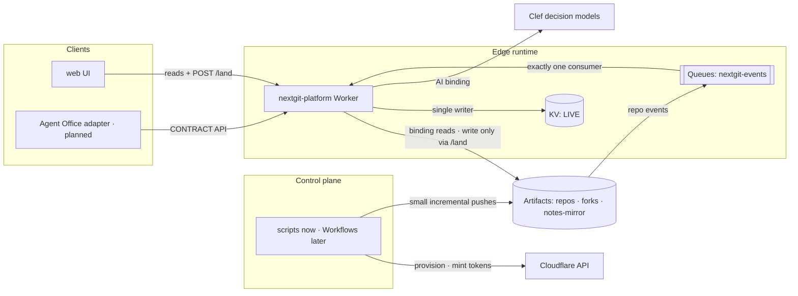
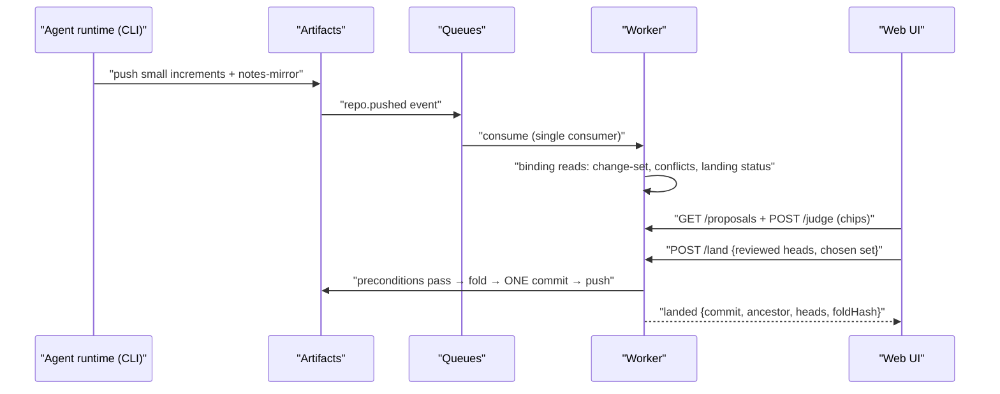
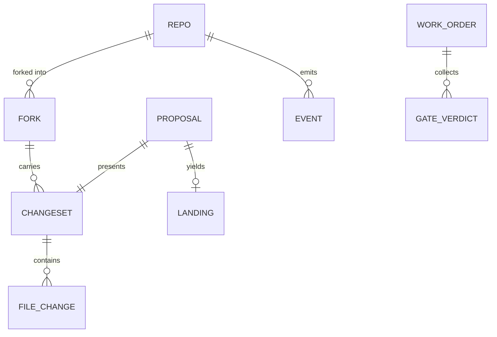

# Architecture Spine — NextGit

## Design Paradigm

**Read-mostly CQRS edge worker.** One named model, four obligations:

- **Commands (writes):** every git write funnels through exactly one gated path — `POST /land` (fold + single commit push). Provisioning and token minting live in the control plane (scripts today, Workflows when provisioning moves worker-side).
- **Queries (reads):** binding-native, side-effect-free, never cloning (`/changes`, `/proposals`, `/merge` preview, `/events`).
- **Judgment:** delegated to Clef (typed answers); policy, weights, and thresholds stay in code.
- **Convergence at set level** is the core act — the queries exist to present the whole set; the command exists to land a chosen one.

Layer → namespace map: edge runtime = `platform/src/` (single Worker); controls = `platform/scripts/` (→ Workflows); clients = `platform/ui/` (→ Agent Office adapter); orchestration = `porting/` + `.omp/`; records = `docs/`.

## Invariants & Rules

Dependency direction (may depend on whom — a rule, not a picture): clients and control plane depend only on the frozen API (`platform/CONTRACT.md`) and the Cloudflare control-plane API; the Worker depends only on its bindings; the loop depends only on the repo and the subagent runtime. Nothing depends on a client.



### AD-1 — One gated write path [ADOPTED]

- **Binds:** all worker routes; base-repo branches
- **Prevents:** ad-hoc write endpoints sprouting per feature; two writers of the same base ref racing, including two invocations of one path (see AD-3's preconditions) and the control-plane replay.
- **Rule:** the Worker performs no git writes except the single-commit fold+push inside `POST /land`, and **the base repo's branches are written ONLY by `/land`**. Control-plane git pushes are limited to provisioning-time baseline content and proposal repos; landing replays are prohibited. Every new mutation is either a `/land`-shaped command or lives in the control plane — never a second writer of base refs.

### AD-2 — Binding-native reads; review never clones [ADOPTED]

- **Binds:** `/changes`, `/proposals`, `/merge`
- **Prevents:** clone-per-review cost, latency, and CPU-budget blowouts.
- **Rule:** change-set, proposal, and merge-preview reads use Artifacts binding reads (`readFile`/`readCommit`/`readTree`/`readBlob`) within the Workers CPU budget (30 s default, 5 min max). No read route shells out to git or clones; the only in-memory clone in the system is inside the `/land` write path.

### AD-3 — Fork-point semantics; reviewed-state landing; content-test verdict [ADOPTED]

- **Binds:** `/changes`, `/proposals`, `/merge`, `/land`
- **Prevents:** baseline-motion misreads; per-unit private diff semantics; "landed" ambiguity; **silent overwrites between concurrent lands**; **landing content a reviewer never saw**.
- **Rule:** change-sets diff against the fork point (most recent commit shared with base, first-parent walk limit 200; base-head fallback). Merge/land use the fork point as the 3-way ancestor. `landing.status` derives from content: zero-change fold → `landed`; `/land` with zero changes → 409 `no-changes`. **Reviewed-state precondition:** `/land` accepts the reviewed base head and proposal heads (additive request fields; contract bumped first) and returns 409 `stale` on mismatch — no silent re-fold. **Concurrency precondition:** after the in-memory clone, `/land` re-reads the base head and returns 409 `base-moved` on divergence; a DO lease (AD-10) replaces this when it arrives. Every landing records ancestor + heads + fold hash; the returned commit is the evidence reference — merged-SHA-equals-tested is checked against the recorded fold hash.

### AD-4 — Secret masking law [ADOPTED]

- **Binds:** every egress channel — response bodies, folds, intent fields, logs, and any model/judge state
- **Prevents:** per-endpoint leak policies; secrets escaping via patches, merged text, conflict text, intent, logs, or AI calls.
- **Rule:** secret-class paths (`.env*`, `*.pem`, `*.key`, `*.p12`, `credentials.json`, `secrets.json`, `.dev.vars`, any path containing `secrets/`) render as key names only (`keys[]`) in ANY response body — never values; secret rows carry no patch, no intent; folds touching them return `withheld-secret` / 409; **no secret-class content may leave the worker in any form, including logs and any AI/judge state** (outbound judgment states are constructed through the masking filter). Free-text channels derived from repo content (intent, notes, error strings) pass a scrub before entering any body: `KEY=VALUE`-shaped values are redacted, and intent is dropped whenever the head commit touches a secret-class path. Widenings of the class list are additive via a CONTRACT bump. Content-detected secrets (non-path) are EITHER a contract-bumped additive status value OR a judge gate — decided once in CONTRACT before that unit ships, never implicit.

### AD-5 — Provenance via the notes mirror; one pusher [ADOPTED]

- **Binds:** intent plumbing; proposal-repo refs
- **Prevents:** readers assuming binding-side `refs/notes/*` access; competing pushers non-fast-forwarding a proposal repo; a stale writer rewinding the mirror.
- **Rule:** intent lives as git notes pushed to `refs/notes/commits` AND mirrored to branch `nextgit-notes` in one push (three refspecs). All readers use the mirror; fallback carrier `NEXTGIT_INTENT/<sha>.txt` lives only on the mirror. **Exactly one pusher per proposal repo: the runner/orchestrator performs the single three-refspec push after commit; agents never push refs** (the CONTRACT recipe is rewritten as runner-executed). The mirror branch is fast-forward-only.

### AD-6 — Event and feed roles [ADOPTED]

- **Binds:** Queues, KV, `/events`, UI freshness
- **Prevents:** double consumers; duplicated feed entries; multi-writer KV drift; unvalidated agent-influenced payloads becoming platform state.
- **Rule:** Artifacts events arrive through exactly one queue consumer (the worker) — **the consumer is the sole recorder of Artifacts events**, deduping on `(type, repo, ref, after)`; `/land` may record optimistically only through the same dedupe helper; envelopes without repo identity are logged and dropped, never recorded partially. The consumer validates payloads (event-type whitelist, repo/ref charsets, hex shas) before recording. KV `LIVE` has exactly one writer (the worker); `/events` serves the ≤50 newest. The feed is a hint, never authority for writes or identity. UI freshness is event-driven, polling only as fallback.

### AD-7 — Control plane owns provisioning and tokens [ADOPTED]

- **Binds:** repos, forks, tokens, scripts, Workflows
- **Prevents:** write-token sprawl; agents holding push credentials; unbounded token lifetimes; credential files outliving their run; discovery gaps hiding proposals.
- **Rule:** forks and repo-scoped tokens are minted via the control plane (Cloudflare API / `platform/scripts/` today; Workflows when provisioning moves worker-side). Agents edit their own clones; the runner/orchestrator commits; the Worker's only push is `/land`. **Token lifecycle:** worker-minted tokens are single-use — minutes-scale TTL, revoked in a `finally`; agent tokens are hours-scale; all token values live mode 0600 outside repos/transcripts, never in logs or argv; mint/use/revoke are audited; control-plane auth uses an account-scoped API token limited to Artifacts permissions — not the wrangler OAuth file. **Provisioning guarantees discoverability before tokens are handed off** (conventions naming, status ready); auto-discovery semantics including pagination are documented in CONTRACT — discovery is a platform promise, not an implementation detail.

### AD-8 — Single shape source; contract-first; pinned defaults [ADOPTED]

- **Binds:** all routes; web UI; any adapter
- **Prevents:** silent shape drift across independently built consumers; new routes shipping without registration; private default-resolution divergence.
- **Rule:** `platform/CONTRACT.md` is the single source of route shapes. Changes are additive-only; a shape change bumps the contract first. **Every new route or payload lands its shape in CONTRACT.md in the same slice that adds it — no producer or consumer ships an undocumented shape; contract-first is a gate** (the `/judge` kinds/envelope and card-signal vocabulary are pinned before the judge wave; the client push-event vocabulary is pinned before a second client consumes it). Default resolution of `base`/`ref`/`baseRef` is identical on every route and pinned in CONTRACT — no private defaults. Every API route enforces its method; unknown API paths return JSON 404 (never asset fallthrough). UI and adapters consume only the documented contract.

### AD-9 — Auth seam: auth-ready, demo-open; zero credential egress [NEW]

- **Binds:** all routes (especially `/land`); future SSO; viewership; elevated reveal
- **Prevents:** auth retrofitted by rewriting handlers; identity bolted into shapes late; credential leakage through any response; the seam remaining a sentence instead of a mechanism.
- **Rule:** **no response ever contains tokens or credentials — no exception; failure paths return fold artifacts only, and no response ever carries shell snippets containing repo content or paths.** The seam: identity = opaque token in a request header (CF Access JWT / Save Point SSO at this seam); a single `authorize(request, env, action, {repo|base})` chokepoint is called by every route; `AUTH_MODE` env defaults to deny — the demo opts in explicitly (`demo`); while demo, a repo allowlist (`demo`, `agent-*`) is enforced on every `base`/`repos` param; edge rate limits cover `/land`, `/merge`, `/proposals`, `/judge`; CSRF protection is required for the future cookie-based SSO path; the read-side ACL model (org/repo → viewer role) is defined with the viewership layer. **CAP-8's elevated reveal requires this seam plus an explicit authorization rule — masked-by-default everywhere until then.** Hard precondition: the seam is enforced before the first non-demo data exists in the namespace.

### AD-10 — Durable Objects, Workflows, R2 are in-scope components [NEW]

- **Binds:** coordination, provisioning, asset tier
- **Prevents:** interim hacks that conflict with each component's arrival; unpinned shared interfaces between the asset pipeline and the diff/merge layer.
- **Rule:** Durable Objects provide leases/locks/session coordination — surgical scope, expiring, advisory-first; **a DO lease serializes lands when it arrives** (until then AD-3's preconditions are the guarantee). Workflows provide provisioning and long-running flows (they take over token minting; AD-7's control-plane role moves intact, and provisioning still guarantees discoverability before handoff). R2 is the blob/asset tier: large files live in R2 with manifests/pointers in Artifacts; the merge/conflict/diff layer operates on Artifacts, never on R2 blobs; **the first R2 slice owns the manifest/pointer format and later slices conform additively; pointer files are non-diffable (metadata-only rendering) and credential-adjacent pointer values follow AD-4.** Each component enters as its own unit; every AD above keeps binding.

### AD-11 — Judge-layer contract (Clef) [NEW]

- **Binds:** `/judge`, `AI` binding, judge chips, auto-land gate
- **Prevents:** per-feature prompt policy; unbounded question shapes; injection-driven decisions; client-side-only gates; silent judge absence.
- **Rule:** all model judgments go through one `POST /judge` using the `AI` binding with `@cf/cloudflare/clef` (model id pinned; a response whose `model` differs ⇒ judge-unavailable ⇒ **fail closed**). Request shape is `{ setId, target {base, repos, refs} }` — caller-supplied `state`/`questions` are prohibited; **state is assembled server-side** by one module that delimits/labels untrusted repo content and strips instruction-like text, and every outbound state passes the AD-4 masking filter. Responses are validated against the typed schema (kind whitelist, ranges; unknown fields rejected). Question sets are versioned in code; thresholds, weights, and labels live in code, tuned only on our own labeled set. **The auto-land gate is evaluated inside `POST /land`, before fold and push** — when engaged and the judge cannot answer, `/land` fails closed (no push); clients render verdicts, never decide them. Auto-land stays off until an injection-testing spike passes on the labeled set, and requires ≥1 non-model corroborating signal (fold status / conflict map). Per-caller budget and rate caps apply.

### AD-12 — Loop machinery governance [ADOPTED]

- **Binds:** `porting/`, `.omp/`, `docs/NEXT-ACTIONS.md`
- **Prevents:** divergent orchestration; unverifiable "done"s; lost state across rewinds; contract drift found only by manual sweep.
- **Rule:** work flows only through the queue → work orders (`porting/wf-template.ddw.js`) → gates. Gate block rule: 0 ship-blockers + 0 highs; only reds introduced by the order block (base-identical reds recorded with owners); verdict normalization fails closed. Disk is truth (`run-state.json` per phase). Workers never commit — the orchestrator commits on green. One writer per file per wave; heal budget per invocation; resumed runs always re-gate. **Platform work orders' VERIFY gates run a contract smoke** — all six routes curled with shapes/enums/status codes asserted (the bootstrap C2/C3 pattern, ratified); `npx tsc --noEmit` joins as the type gate when the hygiene item lands.

### AD-13 — Runtime shape pinned [ADOPTED]

- **Binds:** worker config, dependencies, deploy path, generated types
- **Prevents:** runtime-shape divergence; unpinned toolchain executing `@latest` with account credentials; secrets in logs.
- **Rule:** one Worker (`nextgit-platform`), compatibility date 2026-09-01, no `nodejs_compat` (fs/Buffer shims are in-tree). Dependencies pinned per the Stack table; `engines` pinned in `platform/package.json`. The generated `worker-configuration.d.ts` is regenerated whenever bindings change and kept in sync. **Deploys use the lockfile-pinned local wrangler, never `@latest`.** Worker logs never include Authorization headers or request bodies.

### AD-14 — Client contract [ADOPTED]

- **Binds:** the API surface clients render; adapters; future clients (CAP-9)
- **Prevents:** client-specific hacks on the platform; adapter logic leaking into the core; clients enumerating a stale entity list.
- **Rule:** the 11-entity protocol — Floor/Project, Worker, Task/Queue, Issue, Pull/Proposal, **Pull/Proposal detail**, Presence/Peer, Whiteboard, Services, Settings, Chat/Notifications (authoritative list: `interface-contract.md`) — plus the contract-pinned push-event surface is THE client contract. GitHub-specific semantics (`reviewDecision`, `mergeStateStatus`, `mergeable`) are synthesized in the adapter — never in the client, never in the core.

### AD-15 — Federation boundary [ADOPTED]

- **Binds:** Windows/GPU/macOS workloads; game-industry track
- **Prevents:** hosting non-Cloudflare workloads on Workers; federated runners accidentally becoming second queue consumers or feeding malformed events.
- **Rule:** the platform orchestrates Windows/GPU/macOS workloads (self-hosted runners) and never hosts them. **Federated runners publish results only through the worker-mediated events route** (dedicated federation path consumed by the worker); they never consume `nextgit-events`; the event envelope is contract-pinned before the first runner joins.

## Consistency Conventions

| Concern | Convention |
| --- | --- |
| Naming | routes lowercase as in CONTRACT.md; repos `agent-N`, baseline `demo`; queue `nextgit-events`; Worker `nextgit-platform`; `AD` ids stable — never reused or renumbered |
| Data & formats | ISO-8601 UTC timestamps; errors `{ok:false,error}`; additive JSON keys only; commit messages `land(<repos>): …`; enums frozen: file status `added\|modified\|removed`; conflict kinds `text-conflict\|modify/delete\|add/add\|undetermined\|mergeable\|identical-add\|both-removed`; landing status `ready\|conflict\|landed\|withheld-secret` |
| API edge | every route enforces its method; unknown API paths return JSON 404 (no asset fallthrough); `base`/`ref`/`baseRef` defaults identical on every route and pinned in CONTRACT |
| State & cross-cutting | writes only via `/land` or the control plane; every egress passes the masking law (responses, folds, intent, logs, model states); KV single-writer; queue single-consumer; model ids pinned + logged; commits only on green gates (orchestrator); deploys via lockfile-pinned wrangler |

## Stack

| Name | Version |
| --- | --- |
| Cloudflare Workers runtime | compat date 2026-09-01 (no `nodejs_compat`) |
| wrangler | ^4.147.0 (pinned; `wrangler artifacts` repo commands since 4.92.0 — queue-subscription source flag verified present on 4.147, absent on 4.106) |
| Artifacts | binding `ARTIFACTS` · namespace `nextgit` (open beta) |
| Queues | `nextgit-events` (single consumer) |
| Workers KV | `LIVE` (single writer) |
| Clef (Workers AI) | ids `@cf/cloudflare/clef` · `@cf/cloudflare/clef-flash` (logged per response) |
| isomorphic-git | ^1.43.0 (v1 wire protocol) |
| node-diff3 | ^3.2.1 |
| diff | ^9.0.0 |
| buffer | ^6.0.3 |
| Node (host scripts) | `>=20` (engines pinned in `platform/package.json`; bun runs `scripts/status-index.mjs`) |
| Loop agent route | `commandcode/deepseek/deepseek-v4.1-flash` (harness `agentModelOverrides`) |

## Structural Seed

Deployment and environments: one environment today — the live demo on `nextgit-platform.john-b7d.workers.dev` (account-scoped), deployed by the lockfile-pinned `npx wrangler deploy` from `platform/`. No staging split yet; it arrives with the auth seam and production data (Deferred). Operational envelope: Cloudflare-hosted end to end; no servers to run; the only local dependency is the loop host (Node + subagent runtime).

Convergence flow (the one sequence everything exists to serve):



Core entities (names + relationships only):



```text
cloudflare-git-comp/
  platform/            # the product: Worker + UI + scripts + CONTRACT.md (frozen API)
    src/               # worker modules: index · githttp · land · memfs · globals
    ui/                # browser triage surface + interactive tour (no build step)
    scripts/           # control plane: fanout · seed · agents · real-agents · land
  porting/             # loop machinery: wf-template · wf-batch · tests · certifications
  .omp/                # loop commands + agent rules for this repo
  docs/                # state spine: STATE · CHECKPOINT · LOG · BUILD-LOG · NEXT-ACTIONS
  _bmad-output/        # specs · research dossiers · architecture (this spine)
  research/            # recon briefs + ecosystem feature matrix
```

## Capability → Architecture Map

| Capability / Area | Lives in | Governed by |
| --- | --- | --- |
| CAP-1 concurrent agent workspaces | Artifacts forks · `platform/scripts/fanout.mjs` (→ Workflows) | AD-7, AD-10 |
| CAP-2 change-set capture | Worker binding reads (`/changes`) | AD-2, AD-3 |
| CAP-3 cross-proposal conflict detection | Worker, node-diff3 fold (`/proposals`) | AD-2, AD-3 |
| CAP-4 set-level triage surface | `platform/ui/` consuming `/proposals` + `/judge` chips | AD-8, AD-11, AD-14 |
| CAP-5 intent records | notes mirror + `/changes` intent fields | AD-5 |
| CAP-6 live event pipeline | Queues → worker → KV → UI | AD-6 |
| CAP-7 landing path (+ validation evidence) | `/land` single-commit push; recorded ancestor/heads/foldHash | AD-1, AD-3, AD-12 |
| CAP-8 trust layer | masking law (all egress) · judge layer · reveal behind the auth seam | AD-4, AD-9, AD-11 |
| CAP-9 platform API for clients | `platform/CONTRACT.md` + adapter contract | AD-8, AD-14 |
| CAP-10 fork community + intent router | Post-competition build | AD-8 (API), Deferred |

## Open Questions

- DO/Workflows/R2 introduction slices and order: scheduled as work orders immediately after this spine (user requires demo incorporation).
- Judge question-set v1 contents and labeled-set thresholds: pinned when the P0 judge wave lands (contract-pinned first, per AD-8).
- Loop runner: per-order worktree isolation and parallel orders — v1 is sequential; revisit at fleet-scale demo.
- `/land` hardening slice shape: reviewed-heads fields, evidence object, and the AD-9 allowlist/rate rules ship as one work order (contract bump first).

## Deferred

- **Game-asset pipeline internals** (CDC chunking parameters, exclusive locks, per-file ACLs) — waits for the R2 tier; the first R2 slice owns the manifest/pointer format (AD-10), later slices conform additively.
- **Federation runners** (Windows/GPU/macOS self-hosted) — post-competition; no demo dependency; the boundary and the publish route are fixed (AD-15).
- **Fork community build + intent router** (CAP-10) — post-competition; needs fleet data and matcher design.
- **Staging/production environment split + Save Point SSO wiring** — arrives with the auth seam (AD-9); revisit condition: first non-demo data.
- **Data jurisdiction selection** (us/eu namespaces) — until a non-demo tenant exists.
- **Live-feed transport upgrade** (SSE/WebSocket) — until polling latency is real at scale.
- **Macro-merging, 10M-scale mesh, and the SHOULD/COULD demo list** (auto-changelog, GitLens parity, PM integration, pod visualization) — post-competition increments; the five demo MUSTs are covered by the capabilities above.
